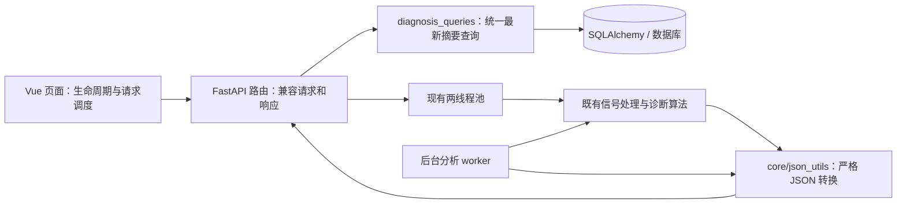

# 架构整顿与响应性能修复记录（2026-10-21）

## 范围与检查点

用户授权先提交既有本地改动，再整顿架构、修复隐藏 Bug 和操作响应问题。

- 分支：`codex/architecture-refactor-20261021`。
- 既有改动检查点：`f128c99`，保存现场交接、论文评估和监测生命周期等原有工作。
- 本轮采用局部重构：保留 FastAPI/Vue/SQLAlchemy 及诊断算法，把已实测的性能和正确性问题集中修复；未整体重写算法、迁移数据源或修改现场参数。
- 本地验证通过不代表线上已改善。未部署、推送、合并主分支或操作生产数据库。

## 调整后的模块职责

`diagnosis_queries` 隐藏了最新记录选择、并列处理和查询字段。总览与两个批次列表共享同一个入口，避免调用方各自选“最新”。数据库只返回各组最新摘要，不把历史完整诊断 JSON 拉回 Python。时间相同时以 id 确定结果，空时间早于有效时间。

JSON 转换属于基础工具，移到 `core/json_utils`；路由包保留兼容重导出。后台分析不再为了调用基础转换函数而依赖整个 DataView 路由包。非有限数字转换为 null，仅表达缺失数值，不产生新的诊断结论。

前端继续使用既有页面和 WebSocket 单例。监测刷新合并、在途请求串行、后续刷新保留；页面卸载释放资源；连接身份校验阻止旧回调修改新连接状态。没有新增状态管理框架或请求库。

## 实际根因、触发条件与验证

| 问题 | 根因/触发条件 | 修改与验证 |
|---|---|---|
| 数据多时列表慢 | 总览逐设备查询、历史逐批查询；摘要读取完整历史 JSON | 批量摘要与聚合统计；SQL 捕获验证查询数及不选取大字段 |
| 两个批次列表健康度不一致 | 一个按分析时间选最新，另一个按数据库返回顺序覆盖 | 统一读模型；用“新时间先插入、旧时间后插入”夹具复现并验证 |
| 研究诊断结果不缓存 | 未导入 timezone，保存时报 NameError 且异常被吞掉 | 显式导入 datetime/timezone；验证插入和同键覆盖均实际落库 |
| 部分算法响应 HTTP 500 | NaN/Infinity 未清理，数组转 list 后不递归 | 公共转换器；严格 `allow_nan=False` 序列化验证 |
| 某次去噪使其他操作一起卡住 | STFT/阶次/倒谱的 async 路由直接调用慢去噪 | 去噪进入现有线程池；实际端点与协程调度测试验证 |
| 总览用久后多余请求、图表不刷新 | await 后注册卸载钩子无效，选中对象仍指向旧数据 | 同步清理、刷新对象、critical/fault 兼容；真实 Vue 测试 |
| 总览推送与轮询叠加、响应倒序 | 多入口直接发查询，慢请求期间可同时产生 4 个请求 | 串行刷新并合并一次后续查询；三项新增回归修复前失败、修复后通过，覆盖失败恢复与卸载 |
| 监测重复请求/旧设备覆盖 | 全设备广播均触发读取、并发响应无设备校验 | 100 ms 合并、设备过滤、串行并保留后续刷新；慢响应回归 |
| 慢采集查询叠加 | 固定间隔调度不等待上一轮返回 | 完成后等待 2 秒再调度，卸载停止；受控 Promise 测试 |
| 重复连接/重连/心跳丢失 | CONNECTING 未去重，旧 close 影响新实例 | 握手幂等、连接身份校验、定时器去重；WebSocket 状态测试 |

## 本地测量

使用隔离内存 SQLite、相同小型夹具，在本机 Windows 测得：

| 场景 | 修复前 | 修复后 |
|---|---:|---:|
| 11 台设备总览 SELECT 数量 | 16 | 3 |
| 16 批历史 SELECT 数量 | 17 | 2 |
| 两个批次摘要函数合计，30 条诊断、每条附 1 万项模拟大字段 | 约 65 ms | 约 7–12 ms |

耗时是开发环境单次样例，非统计压测或线上 P95。SQL 次数与字段断言为确定性检查。没有测量生产数据规模、网络、Nginx 或 CPU 饱和情况下的效果。

## 完成验证

- 后端 10 项通过：9 项读路径/缓存/索引/HTTP 检查，1 项事件循环检查（内部覆盖三个计算端点）。五条 HTTP 请求调用实际注册路由，覆盖总览、全部设备、单设备批次、监测最新、监测历史；使用测试库并覆盖认证依赖，未启动生产后台任务。
- 前端 16 项通过：Monitor 7 项、Dashboard 6 项、WebSocket 3 项。真实 Vue setup/挂载/卸载配合网络与 ECharts 替身，不验证浏览器像素渲染。
- P0 三项脚本通过：None 参数、CPW 鲁棒性、变速阶次跟踪；后者使用本机已有 HUSTbear 数据。测试生成图片不作为源代码改动提交。
- 前端生产构建通过；单文件产物约 2.8 MB，gzip 约 844 KB。较大的首屏传输仍可能影响打开速度，本轮不改变单文件打包方式。
- 最终后端检查使用 Python 3.13.7、FastAPI 0.111.0、Starlette 0.37.2、SQLAlchemy 2.0.36、NumPy 2.4.3、SciPy 1.17.1、Pydantic 2.13.4。新建 cloud/venv 继承本机科学计算包，再在虚拟环境安装缺失依赖；并非严格重建全部 requirements 锁定版本。Pydantic 的既有 class Config 出现弃用提示，未影响当前检查。

可复现命令及每条说明见 [测试索引](tests/INDEX.md)。

## 剩余问题与后续顺序

1. 线上测量：本轮没有连接服务器，不能断言实际网页瓶颈全部来自上述代码。需在部署候选版本后区分 SQL、计算排队、JSON 编码和网络耗时，观察峰值内存与 P95。
2. 数据语义需明确：监测“最新”当前按最大 batch_index，普通 1–16 循环、特殊 ≥101 长期保留，和采集时间最近可能不同；转频来自设备最新诊断，也可能不对应显示批次。为避免擅自改变数据含义，本轮维持既有选择规则。
3. 写入架构：后台分析、实时缓存、重新诊断仍存在重复持久化路径。后续应先验证批次被覆盖时的旧任务写回、通道/去噪缓存版本竞争，再引入统一分析任务与保存模块；不应只抽函数而保留原竞争条件。
4. 资源调度：同步 ORM 仍存在于 async 路由与后台循环，后台数据库事务范围也待进一步核实；全局两线程池并不限制所有第三方数值库线程。WAL/新线程池/任务队列均未基于生产测量验证，因此没有直接启用。
5. 算法有效性：原有 Bug #11d/#13d 未处理；本轮没有重跑 CW/WTgearbox/HUSTgearbox 的完整分类评估，不能据此声称准确率提升。

## PR 前复核补充

代码复核基线为既有改动检查点 `f128c99`，最终 PR 以远端 `origin/main` 为基线；后者额外包含既有 `.gitignore` 提交及 `f128c99` 保存的现场交接、论文评估和监测首屏修复。当前环境未提供子代理工具，规范与需求两个维度由同一 Agent 分别复核，未执行独立并行评审。

- **Standards**：按 `AGENTS.md` 核对线程上限、接口兼容、文档同步、Git 分支边界，并检查命名、重复逻辑和无需求抽象；未发现阻止提交的问题。未改动前端代理或诊断参数。
- **Spec**：发现总览页推送和轮询仍可并发，属于响应优化遗漏；已用三项失败回归复现并修复（Bug #23）。剩余的现场语义和算法有效性问题见上节，不能据此宣称所有隐藏 Bug 已消除。

## 回退与数据库影响

所有工作保留在本地任务分支，既有用户改动由 `f128c99` 保存。新复合索引使用 `checkfirst=True` 在启动初始化时增量创建，已在隔离旧表上重复验证。创建索引可能增加第一次启动耗时；Git 回退只回退代码，不会自动回退数据库结构。没有删表、清空记录或转换业务数据；本轮未在生产库执行索引创建。
