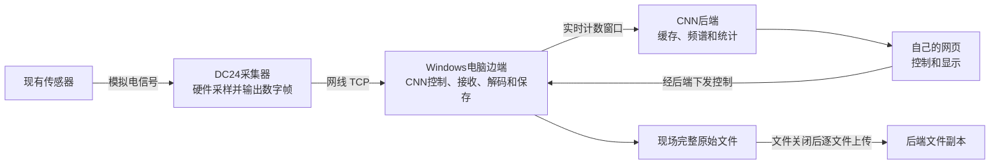

# DC24 数据采集工作交接说明

截至日期：2026年11月7日（北京时间）。

本文以现有源码、工作记录和实测报告为依据，说明已经掌握的信息与已经做成的功能，不是厂家完整协议，也不是后续任务书。本次编写没有重新操作设备或采集数据。

## 1. 目前已经实现什么

**已打通：现有传感器 → DC24采集器 → 网线 → Windows电脑边端 → CNN后端 → 自己的网页实时显示和完整数据保存。**

用户在自己的页面选择采样率、开始示波、开始保存和停止；原厂软件主界面不需要运行。现在既有复用原厂接收DLL的方式，也保留不依赖DLL的纯Python TCP方式。两种方式的硬件采样均由DC24完成，程序收到的是设备发出的数字数据。

| 项目 | 当前状态 |
|---|---|
| 不运行原厂主程序，由自己的程序控制硬件 | 已实现并实测 |
| 原厂接收模块接入自己的系统 | 已实现，使用Windows x86 `JMServer.dll` |
| 不加载原厂DLL的独立网口采集 | 已实现并实测 |
| 四通道波形、频谱、RMS/均值、可选包络谱 | 已实现；主要分析在后端计算 |
| 示波中开始/停止保存，保存后继续示波 | 已实现并实测 |
| 现场完整文件保存、上传后端副本、页面下载 | 已实现并实测 |
| 12个原厂采样率档位 | 已开放，纯Python路径逐档短时试收成功 |
| 实时数据接故障模型、评分、告警 | 当前采集页尚未接通 |
| 树莓派实机采集、边端频谱与小模型 | 尚未实现对应链路或完成实机验证 |

当前现场电脑承担“边端”角色。本机链路成功不等于已经完成公网云端部署、树莓派迁移或实时故障诊断。

## 2. 设备和软件各自负责什么



- **传感器、采集器**：传感器输出电信号；DC24进行模数转换，组织协议帧并通过网线发送。采样不是网页、Python或DLL生成的模拟信号。
- **边端**：下发配置与开始/停止指令，维护连接，接收设备帧，解码四通道原始计数，保存完整记录，并发送实时窗口和文件。
- **原厂DLL（启用时）**：承担监听、接收、连接管理和完整帧回调。CNN继续承担控制流程、校验、计数解码和保存。没有嵌入原厂主界面，也不是读取其波形截图。
- **后端、网页**：后端管理会话、窗口和文件，计算显示所需的分析结果；网页提供操作入口并展示结果。当前页面有频谱，不代表树莓派边端已经完成频谱计算。

## 3. 当前设备与运行配置

| 项目 | 已掌握的信息 |
|---|---|
| 采集器 | 瓦伦尼安DC24，现场铭牌编号`VA00241171` |
| 信号通道 | 固定四路，按采样时刻交错传输 |
| 输入组合 | 四路`IEPE / AC0.2Hz / PASS`，来自用户在原厂确认有效的配置 |
| 默认采样率 | 每通道`10000 Hz` |
| 可选档位 | `50、100、200、500、1000、2000、4000、5000、10000、20000、50000、100000 Hz` |
| 主机有线IPv4 | `192.168.2.100`，本机掩码`255.255.255.0` |
| 设备IPv4 | `192.168.2.101` |
| 设备MAC | `00:08:DC:2B:1A:0C` |
| 主机监听端口 | TCP `6800` |
| 正式系统目录 | `E:/A-codehub/CNN` |
| 原厂软件目录 | `D:/VALENIAN动态采集分析软件`，主程序`DynamicTest.exe` |

采样率按**每通道**计算，四路10000Hz表示每秒约40000个通道数值。以上是当前单台设备和已验证模式的信息，不代表所有型号/固件。

已确认的软件对应是：设备标记0～3 → 页面CH1～CH4 → 原厂软件6-1～6-4。BNC接口到机械测点的逐路独立激励对应尚未单独验证。设备自身子网掩码未读出。

## 4. 已掌握的设备传输协议

详细字节记录见 [DC24实测协议](DC24_PROTOCOL.md)。**第11节是现行输入模板；前面保留的早期电压模板不能作为当前启动配置。**

### 4.1 主机监听，设备主动连接

主机是TCP服务端：绑定`192.168.2.100:6800`、监听、接受设备连接。**不是主机去连接采集器的6800端口。** 设备的TCP源端口会变化，不应写死。

原厂程序与独立程序不能同时占用这个监听地址和端口。普通采集不需要原始抓包权限；此前网卡抓包是额外的独立验证手段。

### 4.2 通用设备帧

| 从0起的帧偏移 | 长度 | 已知含义 |
|---|---:|---|
| 0 | 1字节 | 帧头`7E` |
| 1～2 | 2字节 | **大端**无符号长度`N`，包含命令字及负载 |
| 3 | 1字节 | 命令字或帧类型 |
| 4～N+2 | N−1字节 | 负载 |
| N+3 | 1字节 | 控制校验字节或采样帧尾 |

总帧长为`N+4`。TCP是字节流，一次接收可能得到半帧或多帧；数据内部也可能出现`7E`。现有解析器按长度缓存重组，不把一次接收当一帧，也不靠下一个`7E`判断结尾。

控制帧尾为`(~sum(命令字和负载)) & 0xFF`，因此命令字、负载和校验字节的总和低8位为`FF`。采样帧`80`的尾实测固定为`FF`，**不使用同一个加和校验，尚未验证出有效载荷CRC**。

主机约每秒还发送一个**帧外单字节`00`心跳**。设备有`E0`登录、`E1`保活通知，不属于采样帧。

### 4.3 控制顺序和现行报文

| 顺序 | 命令 | 已验证用途/负载 |
|---:|---|---|
| 1 | `BA` | 查询设备描述，负载为空 |
| 2 | `B8` | 停止已有采样，负载为空 |
| 3 | `B2` | 输入相关整组配置；现行负载`00010001000100010301000000` |
| 4 | `B5` | 采集配置；10000Hz负载`00001c00102700000f000000` |
| 5 | `B7` | 开始当前实时模式，负载`00` |
| 6 | `80` | 持续接收采样帧，期间维护心跳 |
| 7 | `B8` | 结束采样，等待应答后关闭连接 |

除描述查询外，上述控制步骤检查对应应答负载为`00`，不把未知状态当成成功。现行完整配置帧如下，已包含帧头、长度、命令和校验：

```text
B2：7e000eb20001000100010001030100000045
B5，10000Hz：7e000db500001c00102700000f000000e8
```

B5负载第4～7字节（从负载0起计数）是**小端**采样率。现行12档完整负载集中在 [`dc24/dc24_profiles.json`](../dc24/dc24_profiles.json)。新IEPE整组模板直接来自原厂10000Hz抓包，其他档位沿用新基准、仅替换已确认的采样率字段，并已逐档独立短时试收；不是12档新模板都重新从原厂抓取过。

**B2各字节、B5其他字段尚未逐项解明。** 当前采用实测整组配置，没有把未知字节命名为供电、耦合、滤波或帧点数。非标准6000Hz曾实测约6250点/秒，因此目前只开放原厂档位。

### 4.4 四通道采样帧和解码

采样帧类型为`80`，第4～5字节为**小端16位帧序号**。第6字节开始到尾字节之前是采样项，每项4字节：

| 项内位置 | 含义 |
|---|---|
| 第0字节 | 通道标记，当前循环为`00、01、02、03` |
| 第1～3字节 | 小端、有符号24位原始ADC计数 |

等价解码是：将整个4字节项读为**小端有符号int32，再算术右移8位**。计数范围为`-8388608～8388607`。四个相邻项组成一个采样时刻的四路数据；现有实现检查通道标记顺序。

每通道每帧点数为`(总帧长−7)/16`。实测出现过每路254、508、1016、2032点的帧；4071字节对应254点，32519字节对应2032点。**不能把每帧固定成254点。**

帧序号按帧递增，以65536取模检查连续性。代码处理回绕，但短时实测没有覆盖长时间回绕。实时采集中发现设备帧序号不连续会报错，不将缺口两端拼成连续数据。

## 5. 两种接收实现及原厂模块复用

| 项目 | 纯Python TCP | 原厂DLL接收 |
|---|---|---|
| 监听、接收设备连接 | Python标准库socket | `JMServer.dll` |
| 帧重组 | 自己的`Frames`解析器 | DLL完整帧回调，再交现有校验逻辑 |
| 控制、解码、保存、上传 | CNN程序 | CNN程序 |
| 原厂主界面是否需要运行 | 不需要 | 不需要 |
| 元数据`transport` | `python_tcp` | `jmserver` |
| 已有验证 | 独立实机、逐档试收、网页链路 | 模块试验、真实网页和设备全链路 |

当前Windows本机`dc24/.env`已配置`DC24_VENDOR_ROOT`指向原厂安装目录，因此现有页面实时采集走DLL。留空时实时采集使用Python TCP；两者来源都标为`dc24_tcp`，不是文件回放。该设置只影响实时示波/示波中保存，旧单次采集入口仍是原TCP实现。

DLL是**Windows x86（32位）模块**，由独立32位PowerShell进程中的C#桥接调用。当前实现明确依赖Windows的`SysWOW64`路径，不能按现有调用链直接搬到树莓派Linux/ARM上。纯Python采集给出了不依赖该DLL的通信实现，但尚未在树莓派实机验证。

已验证文件为`dll/JMServer.dll`，边端按以下SHA-256校验后才加载：

```text
15295ee583e94c3e9583c71e0de5cc433436ab027c7edd0d57506a43993251df
```

未将原厂二进制文件复制进Git。目前没有厂家完整SDK或正式头文件，调用依据是本机现有程序的兼容性分析与实测，不能推定其他DLL版本兼容。

已用入口包括`InitialDevice`、`StartServer`、`GetLinkCount`、`GetDeviceIP`、`SetCollectState`、`GetCollectState`、`StopServer`和`ReleaseDevice`。完整设备帧由回调事件码`0x06`取得；具体参数和调用约定保留在 [`dc24/dc24_vendor_bridge.ps1`](../dc24/dc24_vendor_bridge.ps1)。

## 6. 页面、原始文件与分析的当前行为

| 操作 | 当前行为 |
|---|---|
| 示波 | 硬件实际采样，保留有界窗口，不创建完整采样文件 |
| 开始采集/保存 | 边端收到控制后，从下一完整帧开始保存；示波继续 |
| 定时结束/停止保存 | 现场文件收尾并上传，示波继续 |
| 停止示波 | 下发B8、等待设备应答；正在保存的记录收尾 |

保存起点是**边端实际执行控制的帧边界**，不是浏览器点击瞬间的硬件触发时间。定时按实际点数控制并按完整帧结束，实际时长可能略长于请求值。

每份新版实时记录含5个文件：

| 文件 | 当前含义 |
|---|---|
| `samples.csv` | `sample_index,time_s,ch0_counts,ch1_counts,ch2_counts,ch3_counts`，保留全部保存样本 |
| `counts.i32` | 按时刻交错的四列小端int32**已解码计数**；不含原设备通道标记低字节 |
| `rx_stream.bin` | 保存区间对应的完整设备采样帧，不是整段网卡抓包，不含保存前示波样本 |
| `commands.jsonl` | 开始保存时的会话近期控制/应答事件快照，不是全程网络审计日志 |
| `metadata.json` | 采样率、点数、时长、首尾帧号、来源、输入模板、B2/B5、保存位置和接收方式等 |

现场原件按页面指定的边端绝对目录保存，每个任务有独立子目录；一键入口默认在`data/dc24_recordings/`。后端副本默认在`data/acquisitions/`，可用`ACQUISITION_DATA_DIR`调整。本机一键运行时，两份文件都在同一台电脑，不能将“上传后端”直接理解为上传到了公网服务器。

实时窗口通过HTTP持续发送；**完整文件是记录结束、文件关闭后再逐个上传**，不是边采边将完整CSV写到云端。文件以流式请求传输，不一次全读进内存。上传失败保留现场原件，尚没有进程重启后自动恢复全部待上传记录的完整机制。

### 数据单位、时间与分析范围

- 原始值为ADC **counts**，不是自动标定后的电压、g或m/s²。已复现过某份原厂文件的工程单位换算，该记录的系数不等于所有传感器的标定。
- 文件时间为`sample_index / sample_rate`，从保存首点起算，不是设备UTC时间。`session_sample_start`对应保存区间在示波会话样本轴中的起点。
- 实时图使用最近连续、最长约2秒的窗口，波形可选择更短展开区间。绘图可保留极值减少显示点，完整保存不抽点。
- 当前实时FFT在**后端**去均值、加Hann窗并计算单边幅值谱；RMS为去均值RMS。包络谱使用指定频带的四阶Butterworth双向滤波、Hilbert包络再做频谱，频带由用户填写。
- 原始波形和CSV不加Hann窗、不平滑拟合，不以分析结果替换原始计数；实时图不是整份长记录的全局统计。

## 7. 边端到后端的现有接口

设备TCP协议与CNN的HTTP接口是两层协议。边端先解码设备帧，实时HTTP上传的是四列原始计数，不是原封不动转发TCP字节流。

| HTTP接口，统一前缀`/api/acquisition` | 当前用途 |
|---|---|
| `POST /agents/heartbeat` | 上报边端来源、版本、输入配置及接收方式 |
| `GET /agents/{agent_id}/control` | 边端轮询示波、保存、停止等控制 |
| `POST /sessions` | 页面创建示波会话 |
| `POST /sessions/{id}/record` | 请求保存；`duration=0`手动结束，正整数为定时秒数 |
| `POST /sessions/{id}/record/stop` | 请求结束保存，继续示波 |
| `POST /sessions/{id}/stop` | 请求结束示波 |
| `POST /sessions/{id}/frames` | 边端上报实时计数窗口 |
| `POST /sessions/{id}/state` | 上报实际执行状态和错误 |
| `GET /sessions/{id}/view` | 页面取得波形、频谱和统计JSON |
| `PUT /jobs/{job_id}/stream-files/{name}` | 上传单个已关闭的文件 |
| `POST /jobs/{job_id}/finish-stream` | 文件齐备后完成保存任务 |

`frames`查询参数含`agent_id`、`start`、`sequence`。`start`为示波会话内从0起的样本索引，`sequence`为本批最后设备帧号。正文是“时刻0四路、时刻1四路……”的**小端有符号int32**，每时刻16字节；后端以`dtype='<i4'`恢复`(样本数,4)`数组，检查24位数值范围。一次HTTP上传可能合并多个设备帧。

断网超过窗口后，实时上传保留绝对样本索引缺口，后端只分析最近连续段，不把缺失时间压缩掉。现场完整保存与实时上传分开；暂时网络故障不直接删除原件。但停止控制也依赖网络，断网时页面不能保证立即停止硬件。

边端使用`X-Edge-Key`请求头，值来自`EDGE_API_KEY`并与后端一致。本文不包含真实密钥或登录密码。当前边端版本为3，旧输入模板版本不能开始新版示波。完整契约见 [接口文档](api/backend_api.md) 及现有路由源码。

## 8. 已做过的验证与已解决的问题

### 同一次原厂采集的逐点对照

曾同步保存原厂文件和该次网口抓包。对齐保存区间后，四路各69632点、共278528个原始数值全部一致；用该记录的换算参数和导出精度也复现了原厂CSV。这证明对应记录的解码与导出换算，不代表所有配置采用同一物理换算系数。

### 纯Python独立控制与新输入模板

在原厂主程序不运行、不加载DLL的情况下，已完成开始、接收、停止和保存。早期5000Hz一分钟记录为每路300228点、60.0456秒，无帧序号缺口。

修正现行IEPE模板后，10000Hz、请求3秒的独立记录和真实网页记录均取得每路30480点、3.048秒；CSV与各自原始报文一致，网页记录后端下载与现场文件一致。纯Python路径以现行模板对全部12档短时试收成功，无帧序号缺口。这不是各档时钟校准或长时稳定性验收。

### DLL接入自己页面后的真实设备验收

使用真实DC24、自己的页面、隔离后端数据库，并独立抓取网卡数据：

| 模式 | 每通道采样率 | 每通道保存点数 | 实际样本时长 |
|---|---:|---:|---:|
| 定时保存，请求2秒 | 10000Hz | 20320 | 2.032秒 |
| 手动开始/停止保存 | 10000Hz | 27940 | 2.794秒 |
| 新会话定时保存，请求1秒 | 100000Hz | 101600 | 1.016秒 |

两次示波会话全程帧序号连续，均收到最终停止应答。三份记录共**599440个四路计数**与网卡抓包独立解码逐点一致，每份5个文件与后端副本逐字节一致。保存结束后示波继续；结束示波后可以改采样率重新开始。

最近DLL集成阶段记录了26项相关自动检查通过，覆盖后端/驱动、边端桥接及采集页。本次仅核对历史报告，没有重新运行这些测试或硬件。

### 两个关键问题的根因和修复

| 问题 | 根因和处理 | 验证结果 |
|---|---|---|
| 原厂改好输入后，独立程序仍采到旧配置信号 | 独立程序每次开始重发旧B2/B5，覆盖设备；已换成用户确认有效的IEPE整组模板，并防止复用旧版边端 | 实际报文、实机保存和网页链路验证通过；字节解码正确不能替代输入配置正确 |
| DLL开始后只收首帧就停止 | CNN发B7后DLL内部仍是未采集状态，自行发B8；已在B7前按设备IP同步`SetCollectState` | 修正后独立试采和网页抓包正常，没有该额外停止指令 |

另已核对实际浏览器ECharts内部序列与同一会话接口，未发现页面替换为模拟正弦或复用同一路数组。显示核对与输入模板验证是不同证据，不能相互替代。

## 9. 正式代码、文档和证据位置

| 路径，相对CNN根目录 | 职责 |
|---|---|
| `start_dc24.bat`、`scripts/dc24_start.py` | Windows一键启动/复用本机服务，不自动开始采样 |
| `dc24/dc24_capture.py` | 纯Python连接、帧解析、指令、单次采集，也是现有协议基础 |
| `dc24/dc24_profiles.json` | 12档现行B5负载 |
| `dc24/dc24_agent.py` | 认证、心跳、轮询与边端入口 |
| `dc24/dc24_live.py` | 持续示波、双接收路径、解码、保存与上传 |
| `dc24/dc24_vendor.py`、`dc24/dc24_vendor_bridge.ps1` | DLL校验及Windows32位进程桥接 |
| `cloud/app/api/acquisition.py`、`cloud/app/api/acquisition_live.py` | 任务、会话、实时窗口和文件接口 |
| `cloud/app/services/acquisition_live.py` | 连续窗口与趋势缓存 |
| `cloud/app/services/acquisition_analysis.py` | 当前FFT、RMS、包络和绘图摘要 |
| `wind-turbine-diagnosis/src/views/Acquisition.vue` | 自己的采集控制和四通道页面 |
| `tests/backend/test_dc24_*.py`、`tests/edge/test_dc24_vendor.py` | 正式测试；运行方式见`docs/tests/INDEX.md` |

本机已有环境的入口是双击`start_dc24.bat`，进入自己的“真实采集”页面；原厂程序需先释放TCP6800。操作细节见 [现场说明](DC24_ACQUISITION.md)。Windows批处理和DLL桥接不是现成树莓派启动脚本。

以下证据只在本机，不随Git分发。本文已写出核心结论；重做逐点复核需另外取得相应原始文件。

| 本机位置 | 内容 |
|---|---|
| `tmp/dc24_live/iepe_profile_20261106/` | 现行输入模板、12档独立试收与网页验证 |
| `tmp/dc24_live/vendor_dll_offline/` | DLL加载、历史字节分片回放验证 |
| `tmp/dc24_live/vendor_dll_live/` | DLL独立试采、首帧自动停止及修正 |
| `tmp/dc24_live/vendor_dll_web/run2/verification.json` | 三份记录及599440个计数核对；同目录有抓包、文件与浏览器记录 |
| `D:/打杂目录/回答师兄/dc24-python/` | 最初探索与原厂同段对照；含历史旧配置，不是现行驱动入口 |

### 版本基线

| 本地提交 | 已完成工作 |
|---|---|
| `c821cb3` | 第一版真实采集页面和完整边端链路 |
| `e9062e0` | 实时示波、示波中保存、一键入口 |
| `02496a3` | 现行IEPE模板与旧边端保护 |
| `c172195` | 原厂DLL接入自己的系统 |
| `e472ab2` | DLL设置和真机验证文档，本文核对的实现基线 |

**共享分支为`交接/DC24网口采集与原厂模块接入`，包含上述完整实现及本交接文档。** 2026年11月7日用户授权将现有分支改为该名称并发布到GitHub仓库`lx827/CNN`，不合并主分支、不创建PR、不部署服务器。发布前核对远端主分支为`82a6d40`，不包含这些DC24实现；接手时应选择共享分支，不能只取主分支。原本地分支名为`codex/dc24-raspberrypi-handoff-20261107`。

## 10. 与树莓派、边端分析和模型有关的已知边界

目前确定：设备使用以太网TCP，已掌握协议子集并有实机验证的纯Python实现；当前复用的原厂模块依赖Windows x86，不能直接按现有方式用于树莓派。**已有独立通信实现，尚无树莓派运行成功的实测结论。**

树莓派型号、内存、系统、联网/上云方式和模型尚未在本次工作中确定。现有工作没有树莓派上的包依赖、目录选择器、服务启动、持续写盘、CPU/内存/温度或推理耗时数据。

按当前四路int32格式计算，每个采样时刻16字节：10000Hz约160000字节/秒，100000Hz约1600000字节/秒。后一档仅`counts.i32`一小时约5.76GB（十进制），不含CSV、设备原始帧、后端副本和网络开销。**这是格式推算，不是树莓派或公网吞吐实测。**

训练与采集当前分开：平时保存数据用于离线训练，本页尚未接模型推理，也没有实现实时训练。既有训练交付边界见 [CQU训练仓库与系统交付说明](CQU_TRAINING_HANDOFF.md)。counts、通道顺序、采样率和输入模板已明确记录；工程单位标定、模型归一化、类别与阈值不能从波形自动推定。

其他未验证范围：连续数小时运行、长时间序号回绕、硬件掉线自动重连、进程崩溃恢复、多采集器、其他固件、转速通道、触发及脱机存储。本文“已完成”的范围以已有实现和上述证据为限。

相关入口：[操作与文件](DC24_ACQUISITION.md) · [协议原始记录](DC24_PROTOCOL.md) · [工作记录](DC24_ACQUISITION_WORKLOG.md) · [测试索引](tests/INDEX.md)。

## 11. 2026-11-07 Rust 边端开发稿交接

用户随后选择推进编译型边端，异常判断在云端，本地先负责设备通信、保存和上传；采样率、时长及间隔留作可调配置。相关 Rust 源码、配置样例、锁文件、测试和未安装的 systemd 模板原归档于 `edge-rust/`（2026-11 布局重构 #46 后平移至 `edge/`），说明见 [Rust 边端 README](../edge/README.md)，过程见 [Rust 工作记录](RUST_EDGE_WORKLOG.md)。

**该目录为开发稿，尚未通过完整编译和端到端测试，没有树莓派实机运行结果。** 已通过 Rust 语法格式及 Cargo 清单/锁文件检查；本机 Windows GNU 链接工具仍有中文路径兼容问题。已有 Python 实机验证结果不能自动算作 Rust 版本的验证结果。

代码沿用现有实时窗口和结束后完整文件上传接口；持续保存期间分段上传完整文件尚未实现。本地频谱、诊断及模型推理也未实现。用户本轮仅授权归档到本交接远端分支，明确暂不部署到树莓派或 ECS，不合并主分支。
