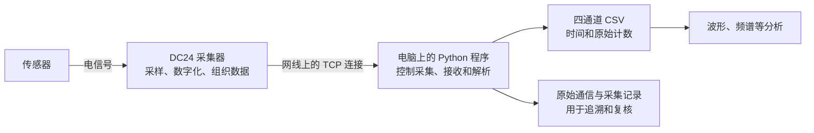

# 从传感器到 CSV：DC24 实际采集链路说明

重点是说明：信号经过哪些环节，我们的程序分别做了什么，以及为什么最终能得到可分析的四通道数据。

文中的设备地址、通道数和验证结果，来自 2026 年 11 月 5 日现场这台瓦伦尼安 DC24 的实测，不代表厂家全部型号和模式。

2026年11月6日补充：当前输入模板已经对齐用户在原厂确认有效的四路IEPE / AC0.2Hz / PASS，默认10000Hz。原厂软件和独立Python各自配置设备，原厂中改好的参数不会自动同步到Python；旧Python会在开始时重新下发旧模板。这次已重新抓取有效配置并更新，故不仅要“解包正确”，还必须“开始采样前配置正确”。详见[现行协议第11节](DC24_PROTOCOL.md#11-2026-11-06现行iepe输入模板与根因修正)。

## 一、先看完整链路



用文字串起来，就是：

**传感器输出电信号 → 采集器把信号变成数字并发出来 → 电脑接收、拆分和解释这些数字 → 按通道保存为 CSV。**

这里的职责要分清：采集器负责完成硬件采样，Python 负责控制它、接收数据和还原格式。CSV 是最后保存数据的一种形式，并不是采集器在网线上直接发送了一张表格。

## 二、传感器到采集器：信号在哪里变成数字

传感器把被测对象的变化转换成电信号。以振动测量为例，设备振动可以通过相应传感器表现为随时间变化的电信号，电缆再把它送到采集器的输入通道。具体使用哪种输入方式、传感器是否需要供电，以及灵敏度如何设置，应按传感器和采集器配置确定。

DC24 对各输入通道进行采样，也就是按一定时间间隔读取信号，并把模拟量转换成数字。我们在这台设备的数据流中已经解析出了四个信号通道的有符号 24 位原始数值。

**5000 Hz 表示每个通道每秒采 5000 个点，不是四路合起来只有 5000 个点。** 相邻点的理论时间间隔是 0.0002 秒。四路采一分钟，每路需要约 30 万点，合起来约 120 万个通道数值。

采样率与信号频率也要区分。采样率描述“读取多快”；频谱里的约 50 Hz 描述“收到的信号包含什么周期成分”。把采样率提高到 5000 Hz，不会让信号本身变成 5000 Hz。

## 三、采集器到电脑：网线连上之后还需要什么

### 1. 两端需要能够通信的网络地址

本次使用的配置为：

| 项目 | 配置 |
|---|---|
| 电脑有线 IP | `192.168.2.100` |
| 电脑有线子网掩码 | `255.255.255.0` |
| 采集器 IP | `192.168.2.101` |
| 电脑监听的 TCP 端口 | `6800` |

网线接通只解决了物理连接。电脑地址不符合设备的通信配置，仍然可能无法正常采集。本次最初电脑使用自动获得的 `169.254.*` 地址；改为设备所寻找的 `.100` 后，才建立了可用的数据连接。

### 2. 这台设备主动连接电脑

本设备的角色分工是：**电脑运行 TCP 服务端，等待设备连接；采集器主动连到电脑的 `192.168.2.100:6800`。**

因此，程序先绑定这个地址并监听，再接受采集器的连接。不能把它理解为“电脑去连接采集器的 6800 端口”。设备自己的 TCP 源端口会变化，不应写死。

原厂程序也使用这个监听地址和端口。所以运行独立采集程序时，需要先让原厂程序释放端口。否则两个程序争用同一个入口，后启动的程序就可能无法监听。

### 3. TCP 解决传输，设备协议决定字节的含义

TCP 向应用程序提供有序的字节流，但它不知道某几个字节代表开始采集、通道编号还是采样值。这些含义由设备自己的通信协议规定。

TCP 也不保证“一次接收就刚好是一条设备消息”。一条消息可能分几次收到，一次接收也可能包含几条消息。因此程序必须先缓存字节，再按设备协议里的长度字段恢复完整消息，不能把每次接收直接当作一个数据包来解析。

## 四、电脑程序怎样让设备开始和停止

建立连接后，程序需要进行一套有顺序的控制操作：

1. **维护连接。** 按已验证方式发送心跳，让连接保持有效。
2. **查询设备。** 接收设备描述，确认对端能够正常应答。
3. **下发采集配置。** 使用已经通过原厂抓包确认的参数组合，包括采样率及相关配置。
4. **开始采集。** 发出开始命令，并检查设备是否返回成功应答。
5. **持续接收采样数据。** 一边接收和解析，一边保存四个通道的样本。
6. **达到目标后停止。** 发出停止命令，检查应答，关闭本次连接并保存采集结果。

目前程序支持原厂列出的12档采样率，从50Hz到100000Hz，固定四信号通道。各档采用从原厂抓到的完整配置，而不是只修改页面数字。非标准的任意整数不一定被硬件准确执行，例如试写6000时实测约6250点/秒，因此页面按用户确认只开放原厂档位。

这些规则来自对原厂正常操作时的通信观察，并已用于独立 Python 实机采集。独立采集时不需要启动原厂软件，也没有调用厂商 DLL。具体命令字、字节格式和样例保存在另一份面向实现者的 [协议说明](DC24_PROTOCOL.md) 中。

## 五、一串字节怎样还原成四条波形

### 1. 先恢复完整的数据帧

可以把“帧”理解为设备协议定义的一条完整消息。程序根据帧头和长度找到边界，再区分它是设备应答、心跳通知，还是实际采样数据。

帧中有帧序号和多通道采样内容。低采样率时曾观察到4071字节一帧，高采样率会更大，程序按报文声明的实际长度处理。序号帮助检查跳帧、重复或顺序异常；长度和帧尾也需检查。控制消息另有加和校验规则，不能把两类消息的检查方法混用。

### 2. 把每个采样项拆成“通道”和“数值”

一个采样项占 4 字节：

| 内容 | 字节数 | 作用 |
|---|---:|---|
| 通道标记 | 1 | 判断这个点属于哪一路 |
| 采样计数 | 3 | 小端、有符号 24 位数值 |

本次数据中的标记按 `0、1、2、3` 循环排列。程序把标记 0 的数放入第一列，标记 1 的数放入第二列，其余同理。通过原厂同段数据对照，已经确认它们分别对应软件通道 `6-1、6-2、6-3、6-4`。

这里的“小端”表示多字节数值从低位字节开始存放；“有符号”表示数值可以为正或负。解析时如果把字节顺序或正负号解释错，即使收到了数据，数值也会不对。

例如4071字节一帧时，包含1016个采样项，四路均分就是**每通道254点**。5000Hz下，这一帧对应每路0.0508秒。高采样率的大帧也按相同四通道顺序拆分；点数从实际负载长度计算，不固定为254。

### 3. 给样本建立时间轴

知道采样率后，可以按样本序号建立相对时间：

`相对时间 = 样本序号 ÷ 采样率`

5000 Hz 下，第 0 点是 0 秒，第 1 点是 0.0002 秒，第 2 点是 0.0004 秒。它表示从本次保存区间开始经过了多久，不是设备提供的绝对日期时间。

### 4. 用实际点数保证采集时长

如果只让电脑等待 60 秒，设备启动和等待数据的时间也可能被算进去，最后保存的样本不足一分钟。因此现在程序按实际收到的点数判断是否完成。

5000 Hz 采一分钟，目标是每通道至少 300000 点。因为按完整帧收尾，实际会略多一些。本次独立实测得到 **1182 帧、每通道 300228 点，即 60.0456 秒**。没有帧序号缺口，按帧到达时间估算的数据速率也与 5000 点/秒/通道一致。

## 六、保存为 CSV 后，数据是什么含义

独立程序保存的表格结构为：

```csv
sample_index,time_s,ch0_counts,ch1_counts,ch2_counts,ch3_counts
0,0.0000000,30321,28897,29785,28357
1,0.0002000,34098,32602,33373,32008
```

上面两个样本取自已验证的原厂保存区间，时间从该区间首点重新记为 0，仅用于说明表格排列。每一行是四个通道同一采样序号的数据，而不是只保存某一路。

**counts 是原始数字计数，不直接等于伏特、g 或 m/s²。** 如果要得到工程单位，还需要对应的换算参数，例如量程、灵敏度和校准系数。原厂 CSV 的数值与原始计数大小不同，不一定是数据不同，也可能只是经过了这一步换算。

本次原厂文件里能读到换算参数。使用相同参数与导出精度后，Python 已经复现了它的 CSV 数值。例如，这段数据第一通道的原始计数 30321，可按本次原厂配置复现为约 36.14655。原厂给这列使用了 `m/s²` 标签，但“复现原厂换算”和“独立证明传感器真实物理单位正确”仍是两件事。

为避免混淆，独立采集脚本默认仍保存原始 counts；需要工程单位时，应明确使用哪套配置及标定来源，不能直接换一个列名就当成真实加速度。

除了 CSV，程序还保留：

| 文件 | 用途 |
|---|---|
| `rx_stream.bin` | 收到的原始字节，便于日后重新解析 |
| `commands.jsonl` | 发了什么控制命令、收到什么应答 |
| `metadata.json` | 采样率、实际点数、时长、通道、序号检查和异常信息 |

这些文件让一份 CSV 有据可查。以后发现问题，可以回到原始数据核对，而不必只凭一张波形图判断。

## 七、怎样证明解析结果与原厂一致

验证的关键是使用**同一次采集、同一段样本**，而不是先用原厂采一段，再换 Python 采另一段。两次采集发生在不同时刻，现场信号本来就可能不同。

实际验证时，用户用原厂软件采集并导出 CSV，我们同时被动抓取该次通信。随后独立解析抓包，找到与原厂保存区间对应的起点，再进行逐点比较。

本次原厂保存区间从完整接收流的第 8192 点开始，四路都相同。对齐后核对结果是：

| 对照内容 | 结果 |
|---|---|
| 四路原始数据，每路 69632 点 | 全部一致 |
| 原厂 CSV 与按相同参数重建的 CSV | 全部数值一致 |
| 总共比较的通道数值 | 278528 个 |
| 最大数值差异 | 0 |

这说明本次配置下的通道拆分、原始数值解释和原厂导出换算已经得到同段数据验证。原厂软件保存有效区间的具体缓存机制尚未完全弄清，但不影响对已对齐样本进行比较。

## 八、现在做到哪里，后续系统应该接哪一段

目前已经完成的是：**DC24 → 现场电脑 → 独立解析 → CSV/原始记录**。已经验证四通道、2000/5000 Hz 配置，完成一分钟采集和原厂同段数据对照。

CNN已加入“真实采集”页面和配套边端，并扩展为实时示波：先示波不保存采样文件，点击采集后从当时开始保存，画面继续更新。可选波形、频谱、RMS/均值、包络谱；时长和现场保存目录可设，根目录启动器一次拉起本机前后端与边端。新版实测4000/20000/100000Hz，页面实时点、CSV和设备原始帧一致。没有部署远端。

连接采集器的现场电脑承担“边端”的角色：它负责与硬件通信、保存完整原始数据，再按系统约定上传。网页负责让用户选择参数和查看状态；云端负责任务管理、接收和分析。**硬件通信仍由现场边端执行，不需要把采集器直接接到云服务器上。**

新增页面改变的是用户操作入口，并不需要再做一套协议解析器。已经验证的连接、控制和解析逻辑应继续复用。训练仓库则负责离线数据准备和模型训练，它与现场采集、系统展示有联系，但职责不同。

本说明没有声称已验证所有采样率、转速通道、触发模式或传感器标定；也没有把“能够采到数据”直接等同于“已经能够可靠判断设备故障”。这些应在相应条件明确后分别验证。

---

实现者继续阅读：[页面与运行说明](DC24_ACQUISITION.md) · [协议细节与验证证据](DC24_PROTOCOL.md)。
