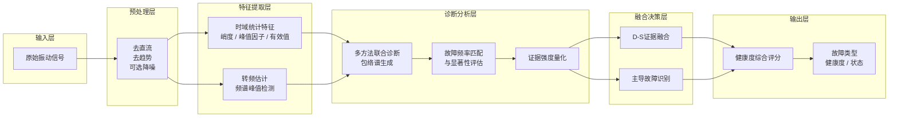
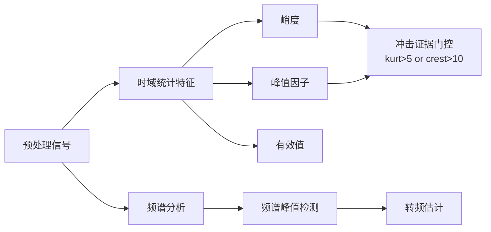
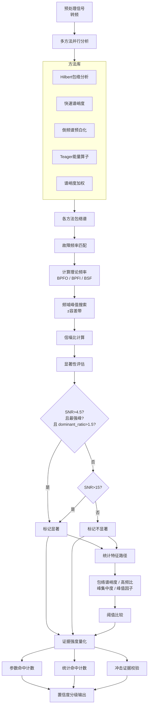
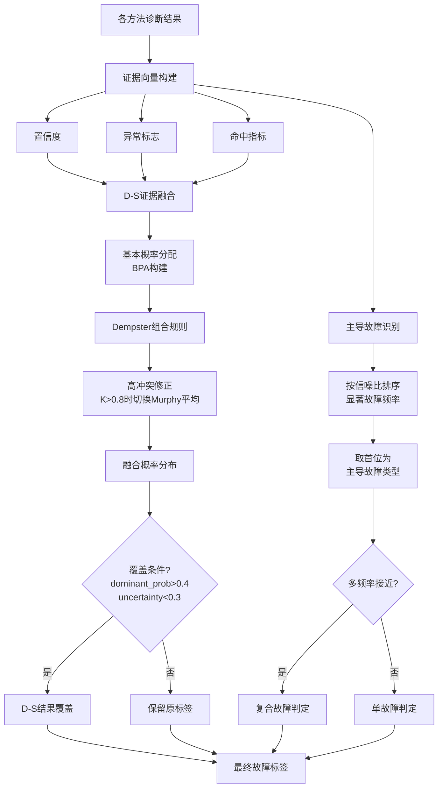
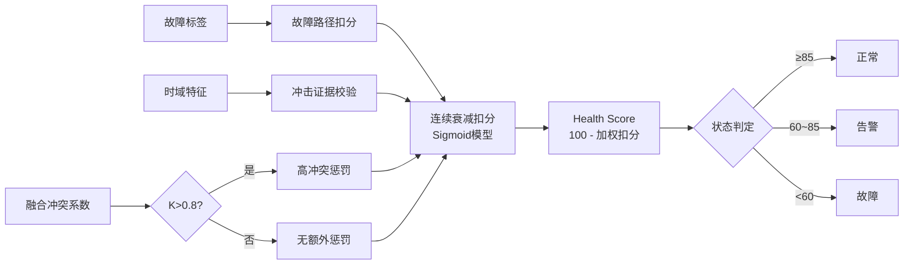

# 轴承故障诊断系统模块化流程图（学术版）

> 按功能模块分层，便于绘制和阅读。每个模块可独立展开细节。

## 第一层：系统级数据流（顶层概览）

---

## 第二层：模块内部展开

### 模块 1：预处理层

**输出**：预处理后的振动信号序列。

---

### 模块 2：特征提取层

**输出**：
- 时域特征向量（峭度、峰值因子、有效值）
- 转频估计值（Hz）
- 冲击证据标志（布尔值）

---

### 模块 3：诊断分析层（核心模块）

**输出**：各方法的故障指示器集合（含物理参数路径与统计路径结果）及对应置信度。

---

### 模块 4：融合决策层

**输出**：故障类型标签（外圈/内圈/滚动体/复合/健康）。

---

### 模块 5：输出层

**输出**：健康度评分（0-100）、设备状态（正常/告警/故障）、故障概率分布。

---

## 模块间接口定义

| 模块 | 输入 | 输出 |
|------|------|------|
| **预处理层** | 原始振动信号 $x(t)$ | 预处理信号 $x'(t)$ |
| **特征提取层** | $x'(t)$ | 时域特征向量 $\mathbf{T}$，转频 $f_r$，冲击标志 $I_{imp}$ |
| **诊断分析层** | $x'(t)$, $f_r$, $\mathbf{T}$, $I_{imp}$ | 故障指示器集合 $\{ind_i\}$，置信度集合 $\{c_i\}$ |
| **融合决策层** | $\{ind_i\}$, $\{c_i\}$ | 故障类型标签 $L_{fault}$ |
| **输出层** | $L_{fault}$, $\mathbf{T}$, 冲突系数 $K$ | Health Score, 状态, 概率分布 |

---

## 绘制建议

**论文中建议分两张图绘制：**

1. **图 1：系统级架构图**（第一层）
   - 5 个模块横向排列
   - 只显示模块名和模块间箭头
   - 每个模块用不同颜色区分

2. **图 2：核心模块展开图**（第三层：诊断分析层）
   - 这是系统最复杂的部分，单独展开
   - 子图方式：左侧"方法库"、中间"故障频率匹配"、右侧"显著性评估"
   - 其余模块（预处理、特征提取、融合决策）如果篇幅允许可各用一个小图或文字描述

**PPT/答辩中建议分 3 张动画幻灯片：**

1. 第一张：系统级 5 模块概览
2. 第二张：诊断分析层展开（核心卖点）
3. 第三张：融合决策层 + 健康度评分（展示智能决策逻辑）
